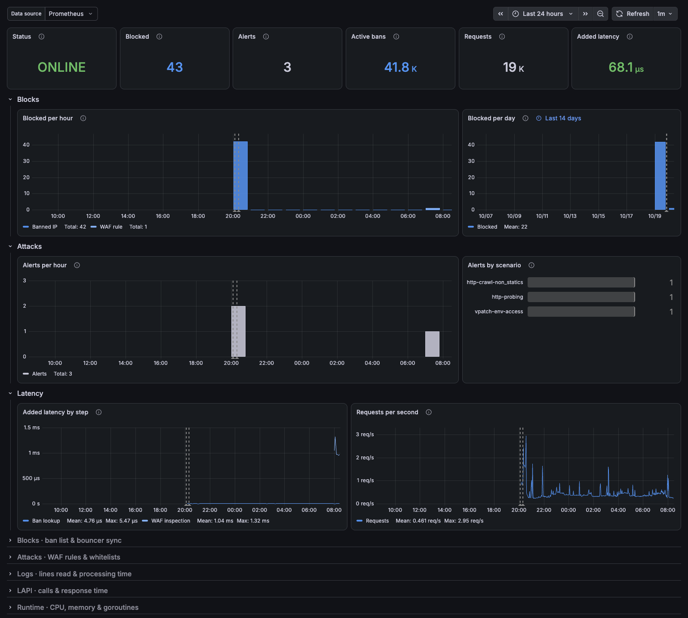
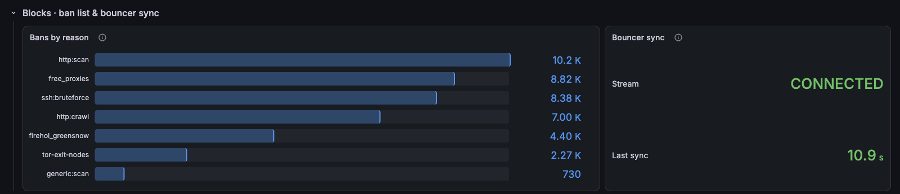
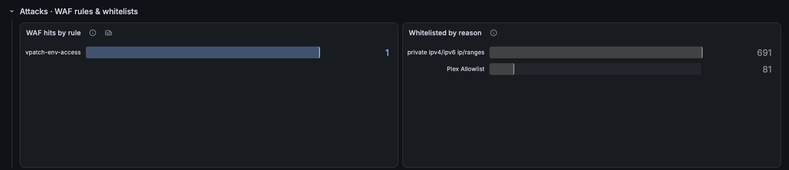
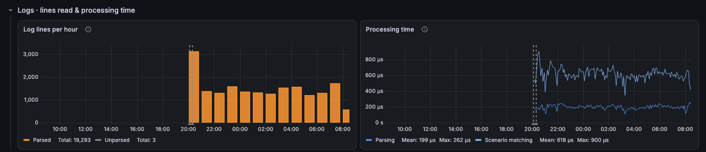
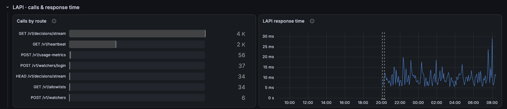
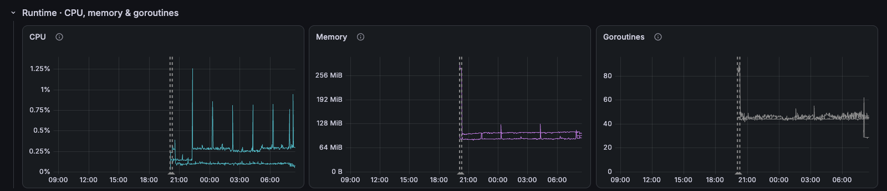

# CrowdSec / Overview

CrowdSec: blocked requests, alerts, bans, added latency, WAF rules, log parsing, LAPI and runtime.

[grafana.com/grafana/dashboards/25948](https://grafana.com/grafana/dashboards/25948) · import ID `25948`

## Overview

Built on the Prometheus metrics exported by [CrowdSec](https://github.com/crowdsecurity/crowdsec) and the [Envoy proxy bouncer](https://github.com/kdwils/envoy-proxy-bouncer). The top row shows whether CrowdSec and the bouncer are up, then requests blocked, alerts raised, bans in force, requests checked and the latency the bouncer adds. Below it, blocks per hour and per day, alerts per hour beside the scenarios behind them, and added latency by step beside requests per second.

Collapsed rows:
- **Blocks · ban list & bouncer sync:** bans in force by behaviour, blocklist or scenario, and the bouncer's decision stream.
- **Attacks · WAF rules & whitelists:** WAF rules that matched, and log events dropped by whitelists.
- **Logs · lines read & processing time:** log lines parsed and unparsed per hour, and parsing and scenario matching time.
- **LAPI · calls & response time:** LAPI calls by route and response time.
- **Runtime · CPU, memory & goroutines:** CPU, memory and goroutines per CrowdSec component.

Notes:
- Blocks, requests and added latency come from the bouncer. CrowdSec itself never learns which requests a bouncer refused.
- Active bans count decisions, so an IP on two blocklists counts twice.
- Latency is an average: the histograms' buckets are too coarse for microsecond medians.

## Requirements
- CrowdSec with Prometheus metrics scraped (`cs_*`, plus the standard `process_*` and `go_*` collectors) from the LAPI and every agent; the helm chart's `serviceMonitor` options do this.
- An AppSec component, for the WAF panels.
- [envoy-proxy-bouncer](https://github.com/kdwils/envoy-proxy-bouncer) with `prometheus.enabled`, for the blocks, requests and latency panels; without it they read "No bouncer".
- Prometheus 2.33 or later, for negative offsets.

## Collapsed rows

### Blocks · ban list & bouncer sync

### Attacks · WAF rules & whitelists

### Logs · lines read & processing time

### LAPI · calls & response time

### Runtime · CPU, memory & goroutines

